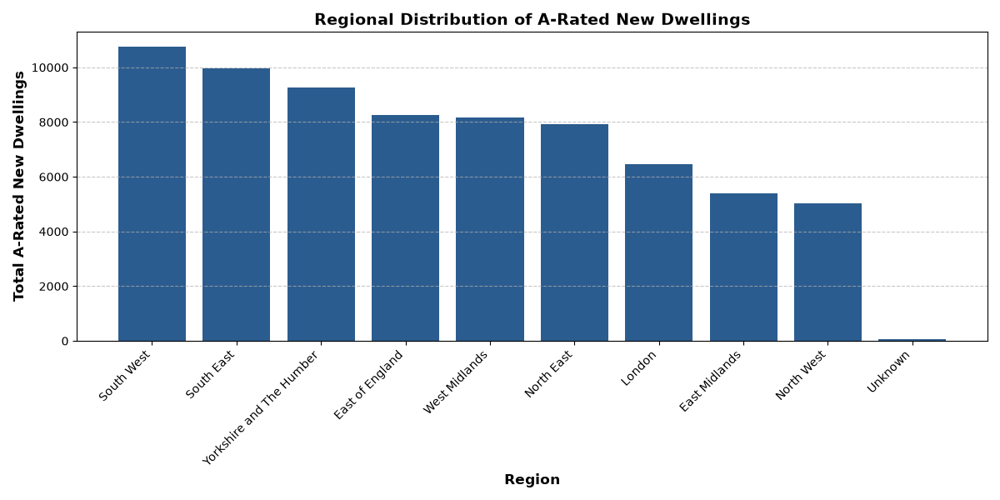

# UK Domestic Energy Data Pipeline 📊🔋

An end-to-end data engineering pipeline designed to extract, clean, store, query, and visualize UK domestic property energy efficiency statistics.

---

## 🛠️ Tech Stack & Tools

* **Language:** Python 3.14
* **Libraries:** `pandas`, `SQLAlchemy`, `psycopg2`, `matplotlib`, `odfpy`
* **Database:** PostgreSQL (v18)
* **Environment:** Windows (PowerShell) / VS Code

---

## 📐 Architecture & Workflow

1. **Ingest & Clean (`read_me.py`)**

   * Reads multi-sheet `.ods` energy property datasets published by GOV.UK.
   * Standardizes string values, strips trailing whitespace, cleans missing/coerced data, and isolates key dimensions (`region`, `quarter`, `a_rated_count`).
2. **Load to Relational Database (`read_me.py`)**

   * Establishes a connection to a local PostgreSQL instance via `SQLAlchemy`.
   * Automatically streams cleaned DataFrames directly into a persistent `energy_dwellings` database table.
3. **Query & Aggregate (`visualise.py` / `psql`)**

   * Executes SQL queries to aggregate A-rated property counts grouped by region in descending order.
4. **Visualize (`visualise.py`)**

   * Pulls SQL query results back into Python and renders a publication-ready regional bar chart exported as `energy_dwellings_chart.png`.

---

## 📈 Visualisations



---

## 🚀 How to Run Locally

1. **Clone the repository:**
   ```bash
   git clone [https://github.com/YOUR_USERNAME/YOUR_REPO_NAME.git](https://github.com/YOUR_USERNAME/YOUR_REPO_NAME.git)
   cd YOUR_REPO_NAME
   ```
